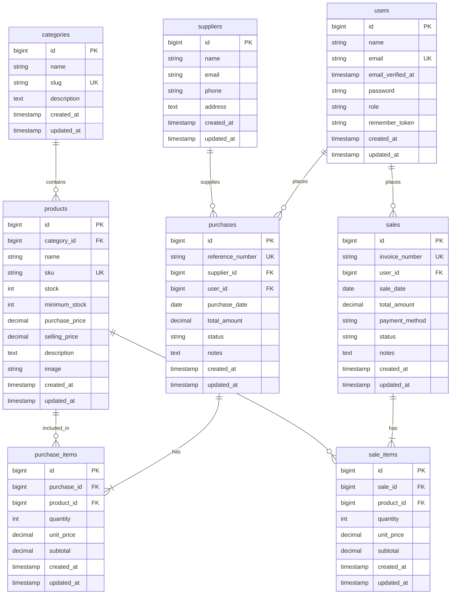

# 🛍️ GoShopping - Smart Retail & Inventory POS System

**GoShopping** adalah aplikasi web manajemen inventaris, *Point of Sale* (POS), dan katalog *e-commerce* berbasis **Laravel** yang dirancang dengan antarmuka modern, responsif, dan kaya warna. Aplikasi ini mendukung sistem *Multi-Role Access Control* (RBAC) untuk Admin, Staff, dan Customer.

---

## ✨ Fitur Utama

### 👑 Portal Admin (Theme: Indigo / Blue)
* **Dashboard Analitik**: Menampilkan ringkasan total omzet, perbandingan pendapatan vs belanja modal (PO), produk terlaris, supplier, dan pengguna.
* **Manajemen Master Data**: Kelola data produk (foto katalog, SKU, harga beli/modal, harga jual, stok fisik, batas minimum stok), kategori, dan supplier.
* **Manajemen Transaksi**: Pemantauan histori transaksi penjualan (sales) dan pengadaan stok (purchases).

### 👔 Portal Staff (Theme: Teal / Emerald)
* **Sistem Kasir (POS Visual)**: Pemrosesan transaksi penjualan barang secara cepat dengan visual produk dan kalkulasi instan.
* **Restock Pembelian**: Pencatatan barang masuk dari supplier untuk menambah stok fisik gudang.
* **Indikator Stok Tipis**: Peringatan otomatis untuk produk yang mencapai batas minimum stok (*Low Stock Alert*).

### 🛒 Portal Customer (Theme: Amber / Rose)
* **Katalog Storefront**: Tampilan *e-commerce* visual interaktif untuk memilih produk berfoto realistis resolusi tinggi.
* **Checkout Instan**: Pemesanan barang mandiri dengan modal interaktif yang terintegrasi langsung dengan validasi dan pemotongan stok fisik di server.
* **Riwayat & Struk Digital**: Riwayat belanja pribadi beserta pencetakan bukti pembayaran / struk digital resmi.

---

## 📊 Skema Database & ERD (Entity Relationship Diagram)

Berikut adalah diagram relasi antar tabel database GoShopping yang dirender secara otomatis menggunakan Mermaid.js:



### 📋 Keterangan Relasi Entitas:
1. **`categories` ke `products`** *(One-to-Many)*: Satu kategori memiliki banyak produk (`nullOnDelete` jika kategori dihapus).
2. **`suppliers` ke `purchases`** *(One-to-Many)*: Satu supplier memasok banyak transaksi pengadaan barang (PO).
3. **`users` ke `purchases`** *(One-to-Many)*: Staf / Admin yang mencatat atau menerima barang masuk.
4. **`purchases` ke `purchase_items`** *(One-to-Many)*: Setiap transaksi pembelian memiliki satu atau lebih rincian item barang beserta harga modal dan subtotal (`cascadeOnDelete`).
5. **`products` ke `purchase_items`** *(One-to-Many)*: Produk yang dibeli dalam pengadaan stok.
6. **`users` ke `sales`** *(One-to-Many)*: Pelanggan yang melakukan pemesanan checkout atau kasir yang melayani transaksi.
7. **`sales` ke `sale_items`** *(One-to-Many)*: Setiap struk faktur penjualan memiliki satu atau banyak baris item transaksi (`cascadeOnDelete`).
8. **`products` ke `sale_items`** *(One-to-Many)*: Produk yang terjual dalam transaksi kasir / pesanan online.

---

## 🛠️ Teknologi yang Digunakan

* **Backend Framework**: [Laravel](https://laravel.com) (PHP 8.2+)
* **Authentication**: Laravel Breeze (Multi-Role Authentication)
* **Database**: MySQL / MariaDB
* **Frontend Styling**: Blade Templating, Tailwind CSS (via CDN), Google Figtree Font
* **Iconography**: FontAwesome 6 Pro Icons

---

## 🚀 Langkah Instalasi & Penggunaan

1. **Clone Repository**
   ```bash
   git clone https://github.com/hidayatiputri-cmd/laravel-inventory-system.git
   cd laravel-inventory-system
   ```

2. **Install Dependensi Composer**
   ```bash
   composer install
   ```

3. **Konfigurasi Environment (.env)**
   Salin file `.env.example` ke `.env` dan sesuaikan koneksi database MySQL:
   ```bash
   cp .env.example .env
   php artisan key:generate
   ```
   *Contoh konfigurasi database pada `.env`:*
   ```env
   DB_CONNECTION=mysql
   DB_HOST=127.0.0.1
   DB_PORT=3306
   DB_DATABASE=inventory_db
   DB_USERNAME=root
   DB_PASSWORD=
   ```

4. **Migrasi Database & Seeding Data Demo**
   Jalankan migrasi tabel dan seeder data awal (produk realistis, supplier, kategori, dan akun demo):
   ```bash
   php artisan migrate:fresh --seed
   ```

5. **Storage Link (Opsional jika upload gambar lokal)**
   ```bash
   php artisan storage:link
   ```

6. **Jalankan Server Lokal**
   ```bash
   php artisan serve
   ```
   Aplikasi dapat diakses melalui browser di: `http://127.0.0.1:8000`

---

## 🔐 Kredensial Demo Akun

Aplikasi telah dilengkapi fitur tombol demo instan pada halaman login (`/login`):

| Role | Email | Password | Akses Cepat URL |
| :--- | :--- | :--- | :--- |
| **Admin** | `admin@inventory.com` | `password` | `/login?role=admin` |
| **Staff** | `staff@inventory.com` | `password` | `/login?role=staff` |
| **Customer** | `customer@inventory.com` | `password` | `/login?role=customer` |

---

## 📄 Lisensi

Proyek ini dirancang di bawah lisensi [MIT](LICENSE).
